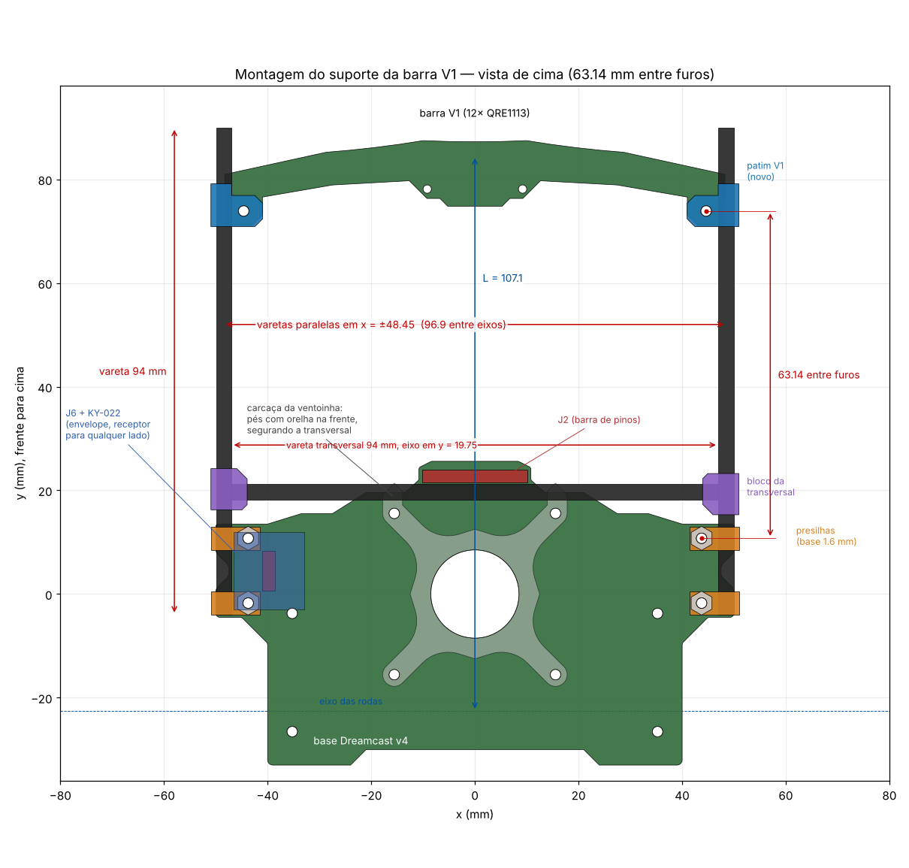
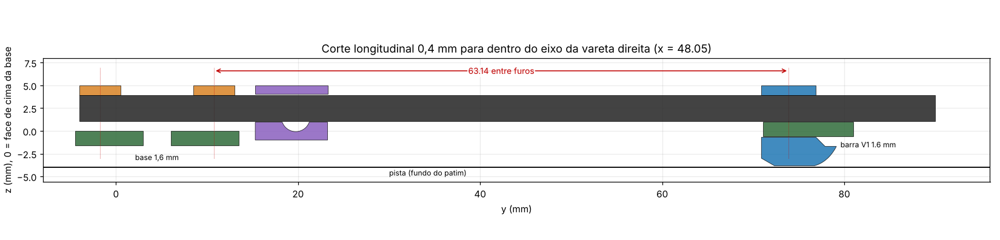

# Mecânica — peças para imprimir e montar

Peças do EVA-RT (© EXOTIC TEAM MX, AGPL-3.0) com o patim da barra V1 feito para o seguidor RUSH - SATURN (repositório `therickmatos/Seguidor-de-linha`, `mecânica/` e `docs/SUPORTE_BARRA_V1.md`) e uma presilha nova para a base de 1,6 mm.
Os arquivos de `stl/` são gerados por `ferramentas/pecas_3d/gerar_pecas.py`; os do EVA-RT são cópias sem alteração de `referencias/eva-rt/3d_models/`.

## O que muda em relação ao seguidor
A base Dreamcast tem os mesmos furos, a mesma borda nas presilhas e a mesma J2 do Saturn (conferido no `.epro` v4). Diferenças:
- **Base de 1,6 mm** (pedido na JLC). O `barilla_clamp` do EVA-RT tem rasgo de 1,0 mm. A presilha de reserva para 1,6 mm do seguidor também não serve aqui: com a vareta nivelada, a cabeça do parafuso, por baixo do braço de baixo, ficaria 0,3 mm abaixo da pista. A presilha deste kit não tem o braço de baixo: a parede externa encosta na borda da placa e o parafuso aperta o braço de cima direto na base, com a cabeça embaixo da placa, a 0,8 mm da pista (figura abaixo).
- **Sem os braços dos sensores de marca.** No lugar do braço há um entalhe na borda (x de ±47,5 a ±50, y de 0,67 a 8,33), entre as duas presilhas de cada lado. As presilhas ficam a 0,17 mm das pontas dele e a vareta passa por cima.
- **J6 (receptor IR KY-022)** em x = −39,8, y = 4,5, perto da presilha esquerda da frente (0,4 mm da fêmea até ela). O módulo fica em pé acima de tudo.
- O patim (versão para barra de 1,6 mm, a espessura da V1), a vareta, o bloco da transversal, a carcaça da ventoinha e a distância de **63,14 mm entre furos** (L = 107,1 mm) são os do seguidor. A distância é ajustável: é só deslizar o patim na vareta.


## O que imprimir (`stl/`)
| Arquivo | Qtde | Origem | Função |
|---|---|---|---|
| `presilha_vareta_base1.6.stl` | 4 | **nova** | presilha da vareta na base de 1,6 mm (sem braço de baixo) |
| `patim_v1_direito_barra1.6.stl` | 1 | seguidor | patim da barra V1 (1,6 mm), lado direito (+x) |
| `patim_v1_esquerdo_barra1.6.stl` | 1 | seguidor | patim da barra V1 (1,6 mm), lado esquerdo |
| `barilla_connection.stl` | 2 | EVA-RT | une a vareta longitudinal à transversal |
| `gearbox.stl` | 1 | EVA-RT | caixa de redução **direita** (pinhão para fora) |
| `gearbox_esquerdo_espelhado.stl` | 1 | EVA-RT espelhado | caixa de redução esquerda (o EVA-RT publica só um lado) |
| `wheel_rim.stl` | 2 | EVA-RT | aro da roda (rolamentos 692ZZ) |
| `impeller_base_1.stl` | 1 | EVA-RT | carcaça da ventoinha (4 pés) |
| `impeller_base_2.stl` | 1 | EVA-RT | parte de cima da carcaça, segura o motor |
| `impeller_fan.stl` | 1 | EVA-RT | hélice |
| `suction_base.stl` | 1 | EVA-RT | placa de sucção, 0,6 mm |
| `battery_holder.stl` | 1–2 | EVA-RT | apoio da bateria na vareta de trás |
| `bead.stl` | ? | EVA-RT | bucha Ø6 / Ø3,15 com furo Ø2,15; ver "Não conferido" |

Não entram: `sensor_sledge.stl` (feito para a barra VISION) e `barilla_clamp.stl` (rasgo de 1,0 mm).

## Material e impressão
Mesma recomendação do seguidor (o EVA-RT não informa material):
- **PETG** nas peças com braço fino que trabalha sob aperto ou que encostam em motor: patins, presilhas, caixas de redução, `impeller_base_1/2`.
- **Hélice:** PETG ou ABS/ASA, 100% de preenchimento, camada de 0,12–0,16 mm. Conferir se gira sem bater antes de dar potência; se vibrar, imprimir de novo.
- **PLA serve** em aro, bloco da transversal, apoio da bateria, bucha e placa de sucção.
- Bico 0,4 mm, camada de 0,12–0,16 mm, 3 perímetros ou mais, 100% de preenchimento.
- Patim, presilha e bloco já estão na posição de impressão (furo da vareta na vertical), sem suporte. Placa de sucção: deitada, 3 camadas de 0,2 mm.
- Furos Ø2,0 e canal de 3,0 mm da vareta saem justos de propósito, como no original. Se não entrar, broca de 2 mm e de 3 mm, à mão.
- Imprimir primeiro **uma** presilha e **um** patim e testar na placa e na barra antes do resto.
- O fundo do esqui desgasta na pista: imprimir um par de reserva.

## Ferragens
| Item | Qtde | Onde |
|---|---|---|
| Vareta de carbono Ø3 mm × 94 mm | 3 | 2 longitudinais + 1 transversal |
| Vareta de carbono Ø3 mm × ~80 mm | 1 | traseira, entre as caixas de redução (comprimento estimado, medir na montagem) |
| Parafuso M2 × 6 + porca M2 | 4 | presilhas: cabeça por baixo da base, porca em cima do braço de cima (base 1,6 + braço 1,0 + porca 1,6 = 4,2 mm) |
| Parafuso M2 × 8 + porca M2 | 2 | patins (cabeça por baixo, porca em cima): braço 1,0 + barra 1,6 + folga 0,1 + bloco 3,5 + porca 1,6 = 7,8 mm, justo; M2 × 10 dá folga |
| Parafuso M2 × 6 + porca M2 | 4 | caixas de redução: pé de 2,5 + base 1,6 + porca 1,6 = 5,7 mm, sem sobra; se a porca não pegar a rosca inteira, M2 × 8 |
| Parafuso M2 × 6, rosca direto no plástico | 4 | por baixo: placa de sucção → base → pés da carcaça (furo Ø1,85, 5 mm de fundo; entram 3,8 mm) |
| Rolamento 692ZZ (2 × 6 × 3) | 4 | dois por aro |

Total: 12× M2 × 6, 2× M2 × 8, 10 porcas M2 (as mesmas do seguidor). Cabeça cilíndrica ou abaulada de até Ø3,8 × 1,6 mm: mais alta que isso encosta na pista (ver alturas abaixo).

## Ordem de montagem do suporte da barra
1. Soldar tudo na base e na barra antes. A J2 tem de ficar reta (a vareta transversal passa a 0,23 mm dela) e a fêmea da J6 também (fica a 0,4 mm da presilha esquerda da frente).
2. Passar cada vareta longitudinal pelo bloco (`barilla_connection`) e pelas duas presilhas. Apoiar as presilhas na base com a parede externa encostada na borda em x = ±50, sobre os furos (±43,75; −1,75) e (±43,75; 10,75). Parafuso M2 × 6 de baixo para cima, porca em cima do braço.
3. Encaixar a vareta transversal nos furos cegos dos dois blocos. Ela fica deitada sobre a base, com o eixo em y ≈ 19,75, logo atrás da J2.
4. Montar a carcaça da ventoinha com **os dois pés de orelha para a frente**: as orelhas prendem a transversal.
5. Encaixar os patins nas pontas da barra (esqui para fora, ponta curva para a frente), M2 × 8 sem apertar, e passar as varetas pelos canais.
6. Deslizar a barra até **63,14 mm** entre o furo da frente da base e o furo da barra, ou 57,89 mm entre a face da frente da presilha dianteira e a face de trás do patim. Conferir os dois lados iguais e apertar.
7. Com a distância aprovada na pista, uma gota de cola (cianoacrilato) em cada patim e cada presilha.

Resultado esperado: varetas paralelas em x = ±48,45, face de baixo da barra a 3,4 mm da pista (QRE a ~1,7 mm; com barra de 1,0 mm seriam 4,0 e ~2,3), L = 107,1 mm.

## Conferência 3D (`ferramentas/pecas_3d/conferir_montagem.py`)
Monta a base lida do `.epro` v4 (com 1,6 mm), a V1 lida do Gerber (com 1,6 mm), varetas, presilhas, blocos, carcaça, patins, parafusos, porcas, placa de sucção, o KY-022 e uma barra de pinos deitada no J3.
- Nenhuma interferência, a não ser a parede da presilha, que entra 0,05 mm na borda da base, como o `barilla_clamp` no próprio EVA-RT.
- Porca da presilha: com uma face virada para a vareta, fica a 0,2 mm do ressalto (como no original) e a 1,2 mm da vareta.
- KY-022 (medidas típicas do módulo, não medidas; receptor virado para qualquer lado): mais de 5 mm de tudo.

**Altura até a pista**, com a vareta paralela à pista (pneu de ~22 mm: o eixo da roda fica 7,0 mm acima da base pela caixa de redução):

| Peça | Altura (mm) | Com base e barra de 1,0 mm (como o EVA-RT) |
|---|---|---|
| face de baixo da base | 2,4 | 3,0 |
| placa de sucção | 1,8 | 2,4 |
| presilhas | 2,3 | 2,0 |
| cabeça do parafuso das presilhas | 0,8 | 0,4 |
| cabeça do parafuso das caixas de redução | 0,8 | 1,4 |
| J3: parte preta da barra de pinos deitada | 0,8 (menos a solda) | 1,4 |
| cabeça do parafuso dos patins | 0,7 | 1,3 |
| bloco da transversal | 3,0 | 3,0 |
| face de baixo da barra V1 | 3,4 | 4,0 |

O resto da mecânica fica em cima da base, então a base mais grossa aproxima da pista tudo o que fica embaixo dela. O regulamento admite desníveis de ±3 mm nas emendas da manta (regra 4.2): conferir na pista se a placa de sucção ou as cabeças raspam. Pneu maior levanta a traseira (1 mm a mais no raio ≈ 0,7 mm a mais nas presilhas).




O corte pelo patim (`conferencia/corte_patim.png`) e a comparação com o patim original (`conferencia/patim_original_x_novo.png`) dependem só da barra (aqui, com 1,6 mm).

Para refazer (Python 3 com `pip install -r ferramentas/pecas_3d/requisitos.txt`):
```
python3 ferramentas/pecas_3d/gerar_pecas.py
python3 ferramentas/pecas_3d/conferir_montagem.py --furos 63.14 --esp-barra 1.6
```
Mudou a distância entre furos ou a espessura da barra: rodar de novo o `conferir_montagem.py`.

## Cuidados
- **J3 (gravação, embaixo):** barra de pinos reta deitada, com os pinos curtos soldados nos pads e a parte preta encostada na borda de trás (y = −30). Os pads acabam a 0,3 mm da borda, então a parte preta fica atrás da placa, centrada no pino, e a 0,8 mm da pista menos a espessura da solda. Não deixar a parte preta embaixo da placa.
- **Cabeças de parafuso:** as dos patins (0,7 mm), das presilhas e das caixas (0,8 mm) são as partes mais baixas depois do esqui. Cabeça mais alta que 1,6 mm encosta na pista.
- **Receptor IR:** o KY-022 fica em pé na J6. Deixar o receptor com vista para onde o juiz fica com o controle.
- **Carcaça da ventoinha:** montar com os dois pés de orelha para a frente.
- **Carbono conduz.** A transversal deita sobre a máscara de solda da base. Sob ela não há via nem pad exposto; os pads mais próximos são os da J2, a 0,7 mm.

## Não conferido
- `bead.stl`: pelas medidas parece uma bucha do eixo Ø2 junto ao rolamento 692ZZ, não um patim. Não achei nas fotos onde vai nem quantas são.
- Eixo das rodas, engrenagem de 64 dentes e pneu (a altura até a pista acima supõe pneu de ~22 mm).
- Encaixe dos motores 1020 nas caixas de redução e na carcaça.
- Comprimento da vareta traseira e posição do apoio da bateria.
- Medidas reais do KY-022.
