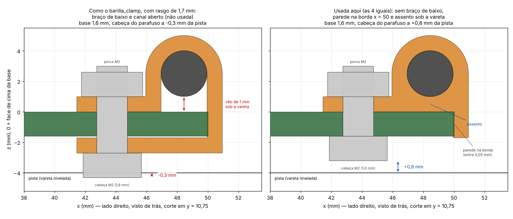

# Mecânica — peças para imprimir e montar

Peças do EVA-RT (© EXOTIC TEAM MX, AGPL-3.0) adaptadas à placa encomendada, **RUSH - Dreamcast v4**, com a **base de 1,6 mm** e a **barra V1 de 1,6 mm**, para imprimir em **PLA e PETG**. O patim, o assento das presilhas e a placa de sucção são os do seguidor RUSH - SATURN ([`therickmatos/Seguidor-de-linha`](https://github.com/therickmatos/Seguidor-de-linha), `mecânica/`).

| Seção | O que tem |
|---|---|
| [O que imprimir](#o-que-imprimir) | STL separados por filamento (`stl/PETG/` e `stl/PLA/`), quantidades e função |
| [Configuração de impressão](#configuração-de-impressão) | bico, camadas, PETG seco, posição de cada peça na mesa |
| [Ferragens](#ferragens) | varetas, parafusos, porcas, rolamentos e cola |
| [Ordem de montagem](#ordem-de-montagem) | passo a passo |
| [Cuidados](#cuidados) | o que pode dar errado na montagem e na pista |
| [Por que as peças mudaram](#por-que-as-peças-mudaram) | base de 1,6 mm e PLA/PETG |
| [Conferência 3D](#conferência-3d) | folgas, vias e altura de cada peça até a pista |
| [Não conferido](#não-conferido) | o que ainda falta medir ou testar |

Os STL são gerados por `ferramentas/pecas_3d/gerar_pecas.py`; os do EVA-RT são cópias sem alteração de `referencias/eva-rt/3d_models/`. A análise completa do suporte da barra (feita para o Saturn, com a mesma presilha de trás e o mesmo patim) está no [`SUPORTE_BARRA_V1.md` do seguidor](https://github.com/therickmatos/Seguidor-de-linha/blob/main/mec%C3%A2nica/SUPORTE_BARRA_V1.md).

## O que imprimir
Imprima uma pasta inteira de cada vez. O motivo de cada filamento está em [Só PLA e PETG](#só-pla-e-petg).

**`stl/PETG/`** (peças sob aperto de parafuso ou perto de motor):

| Arquivo | Qtde | Função |
|---|---|---|
| `presilha_vareta_base1.6.stl` | 4 | presilha da vareta, a mesma nas 4 posições (y = −1,75 e 10,75): parede na borda da base e assento sob a vareta |
| `patim_v1_direito_barra1.6.stl` | 1 (+1 de reserva) | patim da barra V1, lado direito (+x) |
| `patim_v1_esquerdo_barra1.6.stl` | 1 (+1 de reserva) | patim da barra V1, lado esquerdo |
| `barilla_connection.stl` | 2 | bloco que une a vareta longitudinal à transversal |
| `placa_succao_rebaixo.stl` | 1 | placa de sucção de 0,6 mm, com rebaixo para a cabeça do parafuso nos 4 pés |
| `gearbox.stl` | 1 | caixa de redução **direita** (pinhão para fora) |
| `gearbox_esquerdo_espelhado.stl` | 1 | caixa de redução esquerda (o EVA-RT publica só um lado) |
| `impeller_base_1.stl` | 1 | carcaça da ventoinha (4 pés) |
| `impeller_base_2.stl` | 1 | parte de cima da carcaça, segura o motor |
| `impeller_fan.stl` | 1 | hélice |

**`stl/PLA/`**:

| Arquivo | Qtde | Função |
|---|---|---|
| `wheel_rim.stl` | 2 | aro da roda (rolamentos 692ZZ); o PLA acerta melhor a medida do alojamento |
| `battery_holder.stl` | 1–2 | apoio da bateria na vareta de trás (a foto mostra um); serve PETG também |
| `bead.stl` | ? | bucha Ø6 / Ø3,15 com furo Ø2,15 (ver "Não conferido"); serve PETG também |

Origem: presilha, patins e placa de sucção são adaptações; o resto é do EVA-RT como está. Do EVA-RT, não entram: `sensor_sledge.stl` (barra VISION), `barilla_clamp.stl` (rasgo de 1,0 mm) e `suction_base.stl` (substituída pela placa com rebaixo).

## Configuração de impressão
- Bico de 0,4 mm, camada de 0,12–0,16 mm, 3 perímetros ou mais, 100% de preenchimento.
- PETG seco e com retração bem ajustada: fio solto na hélice desbalanceia, e no furo da vareta impede a vareta de entrar.
- Patim, presilhas e bloco já estão na posição de impressão (furo da vareta na vertical), sem suporte. O assento das presilhas fecha um furo vertical e também não precisa de suporte.
- Placa de sucção: deitada, 3 camadas de 0,2 mm, **com os rebaixos para cima** (a face lisa na mesa). Assim o fundo de 0,2 mm é a primeira camada e não precisa de ponte. O STL vem na posição de montagem, com os rebaixos para baixo: **virar a peça no fatiador**.
- Os furos de Ø2,0 e de Ø3,0 da vareta saem justos de propósito, como no original. Se a vareta não entrar, passar broca de 2 mm ou de 3 mm à mão. Como o furo das presilhas agora é fechado, a vareta tem de atravessar as duas presilhas e o bloco: alargar o furo só o bastante para ela deslizar com atrito.
- Hélice: conferir se gira sem bater antes de dar potência. Se vibrar, imprimir de novo.
- Imprimir primeiro **uma** presilha e **um** patim e testar na placa, na barra e com a vareta antes do resto.
- O fundo do esqui desgasta na pista: imprimir um par de reserva.

## Ferragens
| Item | Qtde | Onde |
|---|---|---|
| Vareta de carbono Ø3 mm × 94 mm | 3 | 2 longitudinais + 1 transversal (o EVA-RT usa tubo) |
| Vareta de carbono Ø3 mm × ~80 mm | 1 | traseira, entre as caixas de redução (comprimento estimado, medir na montagem) |
| Parafuso M2 × 6 + porca M2 | 4 | presilhas: cabeça por baixo da base, porca em cima do braço (base 1,6 + braço 1,0 + porca 1,6 = 4,2 mm) |
| Parafuso M2 × 8 + porca M2 | 2 | patins, com a cabeça por baixo e a porca em cima. A pilha é de 7,8 mm (braço 1,0 + barra 1,6 + folga 0,1 + bloco 3,5 + porca 1,6): o M2 × 8 fica justo, e o M2 × 10 dá folga |
| Parafuso M2 × 6 + porca M2 | 4 | caixas de redução. A pilha é de 5,7 mm (pé 2,5 + base 1,6 + porca 1,6), sem sobra: se a porca não pegar a rosca inteira, usar M2 × 8 |
| Parafuso M2 × 6, rosca direto no plástico | 4 | por baixo: fundo do rebaixo da placa de sucção → base → pés da carcaça (furo Ø1,85, 5 mm de fundo; entram 4,2 mm) |
| Rolamento 692ZZ (2 × 6 × 3) | 4 | dois por aro |
| Cola (cianoacrilato; epóxi se o PETG não colar) | — | travar patins e presilhas na vareta, depois de acertar a distância |

Total: 12× M2 × 6, 2× M2 × 8, 10 porcas M2 (as mesmas do seguidor). Um kit M2 de 4 a 10 mm cobre as variações.
Use cabeça cilíndrica ou abaulada de até Ø3,8 × 1,6 mm, sem arruela. Cabeça mais alta encosta na pista (ver alturas abaixo). Nenhuma cabeça fica perto de componente da face de baixo (o mais perto é o D1, a 5,9 mm), e só as cabeças dos pés de trás ficam sobre vias (ver "Cuidados").

## Ordem de montagem
1. Soldar tudo na base e na barra antes. Três cuidados:
   - **Cortar rente**, embaixo, os terminais de J1, J2, J4 e J6 e as pontas dos fios dos motores. Com a base de 1,6 mm sobram só 2,4 mm entre a placa e a pista.
   - Soldar bem retas a J2, porque a vareta transversal passa a 0,23 mm dela, e a fêmea da J6, que fica a 0,4 mm da presilha esquerda da frente.
   - J3 (gravação): ver "Cuidados".
2. Passar cada vareta longitudinal, pela ponta, pelas duas presilhas e pelo bloco da transversal (`barilla_connection`). O furo das presilhas é fechado.
3. Encaixar as presilhas na base, com a parede externa encostada na borda em x = ±50, sobre os furos (±43,75; −1,75) e (±43,75; 10,75). Prender cada uma com M2 × 6 de baixo para cima, com a porca em cima do braço. Entre as duas presilhas de cada lado fica o entalhe da borda; a vareta passa por cima dele.
4. Encaixar a vareta transversal nos furos cegos dos dois blocos. Ela fica deitada sobre a base, com o eixo em y ≈ 19,75, logo atrás da J2. Só encosta na base perto do centro: fora de x ≈ ±13 não há placa embaixo dela.
5. Montar a carcaça da ventoinha com **os dois pés de orelha para a frente**, com as orelhas por cima da transversal. Por baixo, pôr a placa de sucção com os rebaixos virados para a pista. Prender com 4× M2 × 6, que atravessam o fundo do rebaixo e a base e fazem rosca direto no plástico dos pés.
6. Conferir se as 4 cabeças ficaram dentro dos rebaixos.
7. Encaixar os patins nas pontas da barra, com o esqui para fora e a ponta curva para a frente. Pôr o M2 × 8 sem apertar e passar as varetas pelos canais.
8. Deslizar a barra até **63,14 mm** entre o furo da frente da base e o furo da barra. A mesma cota dá 57,89 mm entre a face da frente da presilha dianteira e a face de trás do patim. Conferir os dois lados iguais e apertar.
9. Com a distância aprovada na pista, travar cada patim e cada presilha na vareta com uma gota de cola (ver "Só PLA e PETG").

Resultado esperado:
- varetas paralelas em x = ±48,45;
- face de baixo da barra a 3,4 mm da pista (QRE da barra a ~1,7 mm);
- L = 107,1 mm.

A distância se ajusta deslizando o patim na vareta. Com varetas de 94 mm vai de ~20 a ~73 mm entre furos.

## Cuidados
- **J3 (gravação, embaixo):** é uma barra de pinos reta deitada:
  - os pinos curtos ficam soldados nos pads;
  - a parte preta fica encostada na borda de trás (y = −30), atrás da placa e centrada no pino (os pads acabam a 0,3 mm da borda);
  - fica a 0,8 mm da pista, menos a solda. Não deixar a parte preta embaixo da placa.
- **Cabeças de parafuso:** são as partes mais baixas depois do esqui: 0,6 mm nos pés da carcaça, 0,7 mm nos patins e 0,8 mm nas presilhas e nas caixas.
- **Placa de sucção:** usar a `placa_succao_rebaixo.stl`. Com a `suction_base.stl` original, a cabeça dos pés fica a 0,2 mm da pista. Não abrir o rebaixo até a base: o fundo de plástico isola a cabeça de aço das vias de PWMA_D5, PWMB_D6 e GND. Se 0,6 mm raspar na pista, a alternativa é furo passante de Ø4,4 com parafuso de náilon (0,8 mm).
- **Receptor IR:** o KY-022 fica em pé na J6. Deixar o receptor com vista para onde fica quem aciona o controle.
- **Carcaça da ventoinha:** montar com os dois pés de orelha para a frente.
- **Carbono conduz.** As longitudinais ficam 1 mm acima da placa. A transversal deita sobre a máscara de solda só perto do centro: ali não há via, e os pads mais próximos são os da J2, a 0,7 mm.

## Por que as peças mudaram
### Base de 1,6 mm
O EVA-RT foi feito para base de 1,0 mm. Com 1,6 mm:
- **Presilha da vareta:** o rasgo do `barilla_clamp` é de 1,0 mm. Com o braço de baixo e um rasgo de 1,7 mm, a cabeça do parafuso ficaria 0,3 mm abaixo da pista (figura, à esquerda). A presilha deste kit não tem esse braço: a parede externa desce até a face de baixo da placa e encosta na borda em x = ±50, o que não deixa a peça girar, e o parafuso aperta o braço de cima direto na base, com a cabeça embaixo da placa, a 0,8 mm da pista.
  - É a mesma peça nas 4 posições. No Dreamcast a borda é reta em x = ±50 nas duas, e entre elas fica o entalhe onde o Saturn tem a asa (x de ±47,5 a ±50, y de 0,67 a 8,33). As presilhas ficam a 0,17 mm das pontas dele.
  - A parede entra 0,05 mm na borda, como o `barilla_clamp` no próprio EVA-RT.
  - A presilha de trás do seguidor é esta mesma peça. A da frente de lá é outra, porque no Saturn ela fica sobre a raiz da asa.
- **Placa de sucção:** no EVA-RT, a cabeça dos 4 parafusos dos pés da carcaça aperta a placa de sucção contra a base. Com 1,6 mm, essa cabeça ficaria a 0,2 mm da pista. A placa nova tem um rebaixo de Ø4,4 em cada pé, com fundo de 0,2 mm: a cabeça entra na placa e fica a 0,6 mm da pista. O fundo de plástico continua isolando a cabeça das vias que há embaixo dela (PWMA_D5, PWMB_D6 e GND, nos pés de trás), então não dá para trocar o rebaixo por furo passante com parafuso de aço.
- **Barra V1 de 1,6 mm:** o patim é a versão para 1,6 mm, o mesmo do seguidor. A barra fica a 3,4 mm da pista (4,0 mm com barra de 1,0 mm).
- **Parafusos:** comprimentos conferidos para 1,6 mm (ver "Ferragens").

O que **não** muda em relação ao EVA-RT, ao contrário do seguidor: o bloco da transversal é o `barilla_connection` como está. No Saturn a raiz da asa passa embaixo dele, e o bloco ganhou um rebaixo. No Dreamcast não há placa ali: o bloco fica a 1,8 mm da borda à direita e a 2,7 mm à esquerda.



### Só PLA e PETG
O README do EVA-RT não informa o filamento. Nas fotos, a carcaça da ventoinha é branca, de filamento comum, e as peças pequenas são pretas e foscas. Podem ser de fibra de carbono ou só de filamento preto: não dá para saber. O carbono documentado são as varetas, que são tubos comprados prontos, não impressos.

Sem fibra de carbono, as peças ficam menos rígidas (PETG ≈ 2 GPa, PLA ≈ 3,5 GPa; com fibra, até 2 a 3 vezes mais) e o PETG amolece menos com calor (~80 °C, contra ~55–60 °C do PLA). O que isso muda:
- **Presilhas com assento:** no `barilla_clamp`, o canal da vareta é aberto para a placa, e sobra 1 mm de vão sob a vareta (figura acima, à esquerda). Quem segura a altura dela é só o aperto do plástico, mais cola.
  - Pela estática, o esqui empurra a ponta da vareta para cima, e a vareta tende a girar em torno do bloco da transversal (a única peça que a prende nos dois sentidos). Com isso, a parte de trás desce justamente para o lado aberto das presilhas.
  - Com filamento comum, o aperto é bem mais fraco que com fibra, e o cianoacrilato cola mal no PETG.
  - A presilha deste kit tem o furo fechado embaixo: a vareta fica presa para cima e para baixo e entra pela ponta. A peça ganha ~18 mm³ (de 75,5 para 93,4 mm³).
  - É a única peça que dependia do aperto do plástico para segurar a vareta na altura certa. No patim a vareta já apoia na barra e no assento, e no bloco ela passa por um furo fechado.
- **Cola:** o cianoacrilato cola bem no PLA e mal no PETG.
  - Com o assento, a cola não segura mais a altura da vareta: serve só para travar o patim e as presilhas na posição ao longo dela.
  - No PETG, lixar a superfície antes de colar. Se mesmo assim soltar, usar epóxi, ou uma volta de fita isolante na vareta logo atrás do patim, como batente.
- **Hélice:** a ~50 mil rpm, a tensão na raiz das pás fica em ~5 MPa (estimativa grosseira). É uma fração da resistência do PETG e do PLA, então nenhum dos dois precisa de fibra.

Por que cada peça está em cada pasta:

| Peça | Material | Por quê |
|---|---|---|
| presilhas, patins, bloco da transversal | **PETG** | braço de 1 mm apertado por parafuso e pancada em batida: o PLA racha |
| caixas de redução | **PETG** | seguram o motor 1020, que esquenta; no PLA o motor afrouxa e o engrenamento (módulo 0,3) sai do lugar |
| carcaça (`impeller_base_1.stl` e `impeller_base_2.stl`) | **PETG** | motor da ventoinha encostado |
| hélice | **PETG** | o cubo fica no eixo do motor, que esquenta |
| placa de sucção | **PETG** | o fundo do rebaixo tem 0,2 mm, e a cabeça do parafuso gira em cima dele ao apertar: o PLA trinca |
| aros | **PLA** | alojamento do rolamento preciso (Ø6,19 × 3,0); o PLA acerta melhor a medida |
| apoio da bateria, bucha (`bead`) | PLA ou PETG | sem esforço |

## Conferência 3D
Feita por `ferramentas/pecas_3d/conferir_montagem.py`.
O script monta as peças e lê as placas dos arquivos do repositório:
- a base é lida do `.epro` do v4 (`hardware/placa_base/`), com 1,6 mm;
- a V1 é lida do Gerber (`hardware/barra_v1/`), com 1,6 mm;
- entram também varetas, presilhas, blocos, carcaça, patins, parafusos, porcas, placa de sucção, o KY-022 na J6, a J3 deitada e os componentes da face de baixo (D1 e R20 a R22, como envelopes com a altura máxima do datasheet).

Antes de gravar os STL, o gerador reconstrói o `sensor_sledge` e o `barilla_clamp` originais com os mesmos parâmetros e compara com os STL do EVA-RT. A diferença fica abaixo de 0,1 mm³, em peças de 224 e 112 mm³, o que garante que as medidas lidas estão certas.

A saída completa dos dois scripts (todas as folgas e alturas) está em `conferencia/relatorio.txt`. O que a conferência encontra:
- Nenhuma interferência, a não ser a parede das presilhas, que entra 0,05 mm na borda da base, como o `barilla_clamp` no próprio EVA-RT.
- A vareta atravessa o furo fechado das presilhas e o do bloco sem interferência.
- Bloco da transversal × base: não encosta (1,8 mm à direita, 2,7 mm à esquerda). Por isso o `barilla_connection` fica como está.
- Porca da presilha, com uma face virada para a vareta: 0,2 mm do ressalto (como no original) e 1,2 mm da vareta.
- Cabeças de parafuso × componentes de baixo: nenhum a menos de 2 mm; o mais perto é o D1, a 5,9 mm da cabeça da caixa direita.
- KY-022 (medidas típicas do módulo, não medidas; receptor virado para qualquer lado): mais de 5 mm de tudo. A fêmea da J6 fica a 0,4 mm da presilha esquerda da frente.
- Vias sob as peças (todas tented, pedido da JLC):
  - a cabeça do pé de trás direito fica sobre duas vias de PWMB_D6, em (13,98; −15,09) e (17,13; −15,09), e uma de GND, em (13,98; −16,23);
  - a do pé de trás esquerdo fica sobre uma via de GND, em (−13,86; −15,37). A via de PWMA_D5 em (−17,2; −13,96) fica na borda dessa cabeça, 0,09 mm para fora;
  - o fundo do rebaixo da placa de sucção isola todas elas;
  - as presilhas da direita apoiam sobre vias de GND, mas são de plástico. Nenhuma cabeça de presilha ou de caixa fica sobre via;
  - as varetas longitudinais passam 1 mm acima da placa.

**Altura até a pista**, com a vareta paralela à pista. Supõe pneu de ~22 mm: pela caixa de redução, o eixo da roda fica 7,0 mm acima da base.

| Peça | Altura (mm) |
|---|---|
| face de baixo da base | 2,4 |
| placa de sucção | 1,8 |
| presilhas (parede) | 2,3 |
| cabeça do parafuso das presilhas e das caixas | 0,8 |
| cabeça do parafuso dos pés da carcaça (no rebaixo da placa de sucção) | 0,6 |
| idem, com a `suction_base` original (cabeça sobre a placa) | 0,2 |
| cabeça do parafuso dos patins | 0,7 |
| J3: parte preta da barra de pinos deitada | 0,8 (menos a solda) |
| D1 (SOD-123) | 1,05 |
| resistores 0603 de baixo (R20 a R22) | 1,85 |
| bloco da transversal | 3,0 |
| face de baixo da barra V1 | 3,4 |

Com base de 1,0 mm e as mesmas peças, tudo o que fica embaixo da base estaria 0,6 mm mais alto. O resto da mecânica fica em cima da base.
- O regulamento admite desníveis de ±3 mm nas emendas da manta (regra 4.2): conferir na pista se a placa de sucção ou as cabeças raspam.
- Pneu maior levanta a traseira: 1 mm a mais no raio dá ≈ 0,7 mm a mais nas presilhas.


O corte pelo patim (`conferencia/corte_patim.png`) e a comparação com o patim original (`conferencia/patim_original_x_novo.png`) dependem só da barra. As fotos do EVA-RT montado estão em `conferencia/eva-rt_fotos_montagem.jpg`.

Para refazer (Python 3 com `pip install -r ferramentas/pecas_3d/requisitos.txt`; rodar na raiz do repositório):
```bash
python3 ferramentas/pecas_3d/gerar_pecas.py
```
```bash
python3 ferramentas/pecas_3d/conferir_montagem.py --furos 63.14 --esp-barra 1.6
```
Se mudar a distância entre furos ou a espessura da barra, rodar de novo o `conferir_montagem.py`.

## Não conferido
- `bead.stl`: pelas medidas, parece uma bucha do eixo Ø2 junto ao rolamento 692ZZ, não um patim. Não achei nas fotos onde vai nem quantas são.
- Eixo das rodas, engrenagem de 64 dentes e pneu. A altura até a pista acima supõe pneu de ~22 mm.
- Encaixe dos motores 1020 nas caixas de redução e na carcaça.
- Comprimento da vareta traseira e posição do apoio da bateria.
- Medidas reais do KY-022.
- Módulo HC-05 em pé na J4: a conferência não inclui a J4 nem o módulo.
- Nada foi impresso nem testado fisicamente: a conferência foi toda em 3D.
